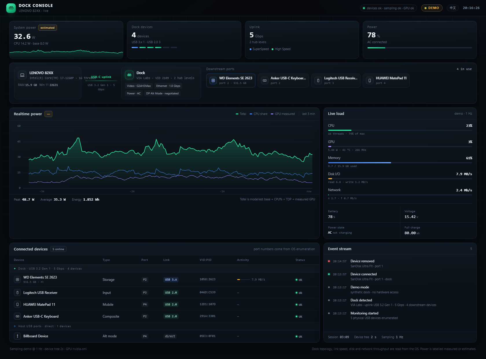

# Dock Console

**English** · [简体中文](README.zh-CN.md)

A real-time dashboard for the USB-C dock or hub plugged into your computer, served on localhost. It shows what is behind the dock, at what link speed, what just got plugged in — and where the power is going.



No dependencies. Node 16+. Reads the operating system's own device tree; it does not install a driver, a kernel extension or a background service.

```bash
npx dock-console
```

Or without a dock attached — synthetic data, same interface:

```bash
npx dock-console --demo
```

---

## What it shows

- **Link strip** — host → uplink → dock → port chips, so you can see what hangs off which port.
- **Power chart** — total draw with the CPU and GPU contributions, 1 Hz, hover for exact values.
- **Load** — CPU, GPU, memory, disk and network, plus battery voltage and health.
- **Device table** — every USB node, split into *behind the dock* and *directly on the host*, with port number, negotiated speed, VID:PID and live disk throughput.
- **Event stream** — hot-plug, dock connect/disconnect, ethernet link changes, AC/battery transitions.

## Platform support

| | Windows | macOS | Linux |
|---|---|---|---|
| Dock topology, ports, VID:PID | `pnputil` | `system_profiler` | sysfs |
| **Negotiated link speed** | inferred from the hub model | `system_profiler` | `…/speed` |
| CPU / memory | PDH via `typeperf` | `top` | `/proc` |
| Disk / network throughput | PDH | `iostat` + `netstat` | `/proc` |
| GPU utilisation and watts | `nvidia-smi` | `nvidia-smi` | `nvidia-smi` |
| **CPU package watts** | — | — (needs root) | RAPL |
| **Whole-machine watts** | modelled | measured on battery | measured on battery |

Windows does not expose a per-device or per-rail power figure to user space, so there the total is a model. Everywhere else it can be a measurement. The UI labels which one you are looking at, and never presents an estimate as a reading.

## Where the numbers come from

This is the part that matters in a tool like this, so it is spelled out rather than buried:

| Reading | Source | Real? |
|---|---|---|
| Device tree, port numbers, VID:PID, dock detection | OS device enumeration | measured |
| Hot-plug events | diff of consecutive enumerations | measured |
| Disk / network throughput, CPU, memory | OS performance counters | measured |
| GPU utilisation, temperature, **watts** | `nvidia-smi` | measured |
| **CPU package watts** (Linux) | RAPL energy counter | measured |
| **System watts on battery** | battery voltage × amperage | measured |
| System watts on AC, and everywhere on Windows | `base + CPU% × TDP + GPU + disk` | **estimated** |

The power badge on the KPI card reads either **measured** or **estimated**, and the footer says which formula is in play. A GPU line is hidden entirely when `nvidia-smi` is absent, rather than drawn at zero.

What it cannot tell you: which physical port carries your display signal. No mainstream OS exposes that mapping, so the channel row shows the display and says nothing about the path.

## Options

```
--port <n>        HTTP port (default 8787)
--host <addr>     bind address (default 127.0.0.1 — localhost only)
--demo            synthetic dock, no hardware access
--no-open         don't launch a browser
--no-power        hide the power panel
--cpu-watts <n>   peak CPU package power used by the estimate (default 45)
--config <file>   path to a JSON config file
-h, --help
-v, --version
```

## Config

Copy `config.example.json` to `config.json`. Everything is optional:

```json
{
  "port": 8787,
  "dock": {
    "name": "My dock",
    "vendorId": "2109"
  },
  "power": {
    "baseW": 8,
    "cpuIdleW": 4,
    "cpuMaxW": 45
  }
}
```

`power.cpuMaxW` is the only value you are likely to want to change — it should be your CPU's sustained package power (PL1), not its turbo figure. `dock.vendorId` pins detection to one hub vendor when the automatic choice picks the wrong tree.

## Interface language

The UI follows your browser language (English, 简体中文) and can be switched at runtime with the button in the top right; the choice is remembered. `?lang=zh` / `?lang=en` force one.

## How it works

```
src/
  index.js            orchestration, 1 Hz frame assembly, SSE broadcast
  platform/
    win32.js          PowerShell collector + typeperf
    darwin.js         system_profiler + top + iostat + netstat + ioreg
    linux.js          sysfs + procfs, no child processes
  model.js            platform-neutral device model, dock detection, diffing
  power.js            source priority: battery > RAPL > model
  server.js           static files + SSE
public/               the dashboard (vanilla JS, canvas, no framework)
test/                 parser fixtures + end-to-end smoke test
```

The platform layer is the only place that knows what OS it is on. Everything above it works on a normalised device shape:

```js
{ id, parent, desc, busname, vid, pid, speed, isHub, root, physical, kinds }
```

Linux and macOS adapters fill `speed` with the device's negotiated rate, which is why they can show "USB 3.2 Gen 1 · 5 Gbps" per device instead of guessing. Windows gets `—` there and falls back to inferring the lane from hub descriptions.

Events are emitted as a translation key plus parameters, never as pre-rendered prose, so switching language re-renders the history too.

## Tests

```bash
npm test        # 37 unit tests — parsers, device model, power priority
npm run smoke   # boots the real server in demo mode and walks the HTTP surface
```

The Linux and macOS adapters cannot be executed on a Windows development machine, so their parsers are pure functions over file contents and are covered with fixtures. The smoke test runs on all three platforms in CI (`.github/workflows/ci.yml`).

## Known limitations

- **Windows has no per-device wattage.** USB port power is not exposed; the total is a model and is labelled as one.
- **macOS disk throughput is read+write combined.** `iostat` does not split it; the UI says so instead of inventing a direction.
- **macOS needs Accessibility permission** for nothing, but `system_profiler` takes ~1–2 s, so the device tree refreshes every 4 s there.
- **Port numbers are OS enumeration addresses** (`Port_#0004.Hub_#0006`), not the numbers silkscreened on the case. They rarely match.
- **The dock is auto-detected** as the hub subtree with the most interesting topology (HS+SS pair, nested hubs). A dock without an internal hub cannot be distinguished from a plain device.

## Roadmap

- Per-port current draw on Linux (`…/power_supply` where the hub exposes it)
- CSV export of the power history
- Notifications on dock disconnect / over-current

## License

MIT. See [LICENSE](LICENSE).
